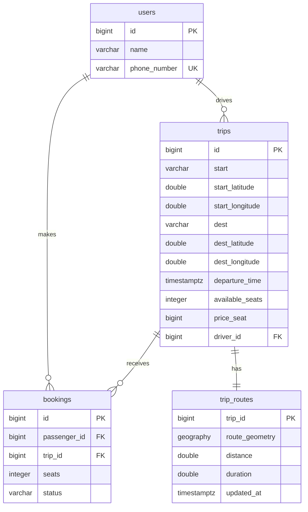

# carpool

A full-stack ride-sharing application. Passengers search for trips along a route, view the driving route on a map, and book seats. Drivers publish trips and share their rides.

## Features

- Search trips by start, destination, date, minimum seats, and maximum price
- Trip details with an interactive Mapbox map, route geometry, distance, and estimated driving time
- Book and cancel seats, with seat availability updated transactionally

## Architecture

```
Browser
  │
  ▼
Nginx
  │  /api/*
  ▼
Spring Boot REST API ──► PostgreSQL + PostGIS
  │                         users, trips, bookings, trip_routes
  │
  ├──► OpenRouteService  (driving route geometry, distance, duration)
  └──► Nominatim / OSM  (address geocoding)
```

The frontend is a static React SPA served by Nginx. API requests are proxied to the Spring Boot backend. When a trip is created, the backend geocodes the start and destination, requests a driving route from OpenRouteService, and stores the route as a PostGIS `LineString` for fast proximity search.

## Tech stack

| Layer | Technology |
| --- | --- |
| Frontend | React , TypeScript, Vite|
| Backend | Java, Spring Boot |
| Database | PostgreSQL with PostGIS |
| CI/CD | GitHub Actions |

## Repository structure

```
.
├── compose.yaml
├── .env
├── backend/
│   ├── src/main/java/com/carpool/backend/
│   │   ├── user/
│   │   ├── trip/
│   │   ├── booking/
│   │   ├── exception/
│   │   ├── Geocoding.java
│   │   └── OrsRoutingService.java
│   ├── src/main/resources/db/migration/
│   └── src/test/java/
├── frontend/
│   └── src/
│       ├── components/
│       ├── types/
│       └── App.tsx
└── .github/workflows/ci.yml
```

## Prerequisites

- Java 25, Node.js 22+, and a PostgreSQL 17 + PostGIS instance
- An [OpenRouteService API key](https://openrouteservice.org/dev/)
- A [Mapbox access token](https://account.mapbox.com/access-tokens/)

## Configuration

Create a `.env` file in the repository root:

```dotenv
DB_USER=carpool
DB_PASSWORD=change-me
ORS_API_KEY=your-openrouteservice-api-key
```

| Variable | Description |
| --- | --- |
| `DB_USER` | PostgreSQL user |
| `DB_PASSWORD` | PostgreSQL password |
| `ORS_API_KEY` | OpenRouteService API key |
| `SPRING_DATASOURCE_URL` | JDBC URL, e.g. `jdbc:postgresql://localhost:5433/carpool` |
| `SPRING_DATASOURCE_USERNAME` | Database user |
| `SPRING_DATASOURCE_PASSWORD` | Database password |
| `ORS_APIKEY` | OpenRouteService API key |
| `VITE_MAPBOX_TOKEN` | Mapbox public access token |


## Running with Docker

```bash
# 1. Create the .env file shown in Configuration above

# 2. Build
docker compose up --build
```

| Service | URL |
| --- | --- |
| Frontend | http://localhost:3000 |
| Backend API | http://localhost:8080 |
| PostgreSQL | `localhost:5433` (database `carpool`) |


## Running locally

### 1. Start the database

```bash
docker compose up -d db
```

### 2. Start the backend

```bash
cd backend
./mvnw spring-boot:run
```

### 3. Start the frontend

```bash
cd frontend
npm ci
npm run dev
```

## API reference

Base URL: `http://localhost:8080`. All request and response bodies are JSON.

### Users

| Method | Path | Description | Body |
| --- | --- | --- | --- |
| `GET` | `/api/users` | List all users | — |
| `GET` | `/api/users/{id}` | Get a user by ID | — |
| `POST` | `/api/users` | Create a user | `{ "name": "...", "phoneNumber": "..." }` |
| `PUT` | `/api/users/{id}` | Update a user | `{ "name": "...", "phoneNumber": "..." }` |
| `DELETE` | `/api/users/{id}` | Delete a user | — |

### Trips

| Method | Path | Description | Body / query |
| --- | --- | --- | --- |
| `GET` | `/api/trips` | List all trips | — |
| `GET` | `/api/trips/{id}` | Get a trip by ID | — |
| `POST` | `/api/trips` | Create a trip | see below |
| `PUT` | `/api/trips/{id}` | Update a trip | same as create |
| `DELETE` | `/api/trips/{id}` | Delete a trip | — |
| `GET` | `/api/trips/{id}/route` | Get the saved route geometry, distance, and duration | — |
| `GET` | `/api/trips/search` | Exact, case-insensitive location search | `start`, `dest`, `date`, `minSeats`, `maxPrice` (all optional) |
| `GET` | `/api/trips/nearby` | Route-proximity search (5 km) | `start`, `dest` (required), `date`, `minSeats`, `maxPrice` |

Create/update trip body:

```json
{
  "driverId": 1,
  "start": "Hanoi",
  "dest": "Hai Phong",
  "departureTime": "2026-11-01T08:30:00",
  "availableSeats": 3,
  "priceSeat": 150000
}
```

### Bookings

| Method | Path | Description | Body |
| --- | --- | --- | --- |
| `POST` | `/api/bookings` | Create a booking and reserve seats | `{ "passengerId": 2, "tripId": 1, "seats": 2 }` |
| `GET` | `/api/bookings/{id}` | Get a booking by ID | — |
| `GET` | `/api/bookings/passenger/{passengerId}` | List a passenger's bookings | — |
| `GET` | `/api/bookings/trip/{tripId}` | List bookings for a trip | — |
| `DELETE` | `/api/bookings/{id}` | Cancel a booking and release its seats | — |


## Data model



- **`users`** — accounts identified by a unique `phone_number`.
- **`trips`** — rides with geocoded start/destination coordinates, departure time, remaining seats, and price per seat. `driver_id` references `users`.
- **`bookings`** — links a passenger to a trip with a seat count and `CONFIRMED`/`CANCELLED` status.
- **`trip_routes`** — holding the route as a PostGIS `geography(LineString, 4326)`, distance and duration. A GiST index on `route_geometry` supports proximity search.

## Tests

```bash
# Backend tests
cd backend
./mvnw test

# Frontend lint and production build
cd frontend
npm run lint
npm run build
```

### CI

`.github/workflows/ci.yml` runs on pushes and pull requests to `main`:

1. **Backend tests** against a `postgis/postgis:17-3.5` service container
2. **Frontend lint and build**
3. **Docker images** — on pushes to `main`, builds and publishes to Docker Hub

## Known limitations

- **No real authentication.** Logging in fetches all users and matches a phone number on the client. Passwords, sessions, and JWTs are not implemented. Do not use this as-is in production.
- **Delete-trip UI is not wired up.** The `DELETE /api/trips/{id}` endpoint exists, but the "Delete trip" button in *My Trips* is a placeholder.
- **External service dependency.** Creating a trip fails if Nominatim geocoding or OpenRouteService is unavailable or the API key is invalid. Nominatim requests are rate-limited to roughly one per second.
